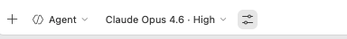
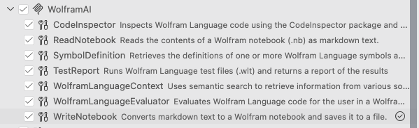
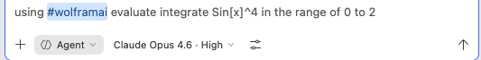
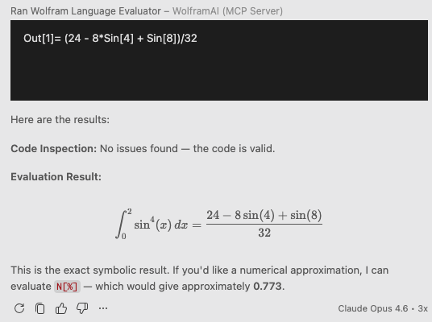
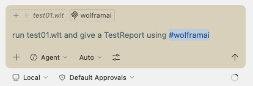
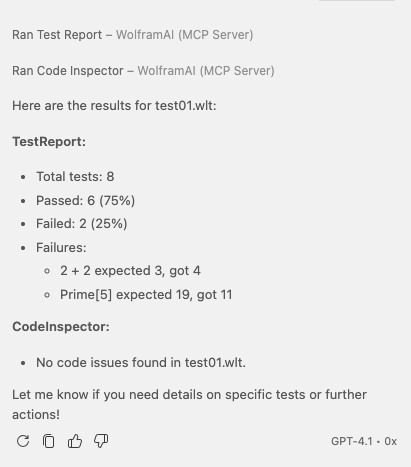
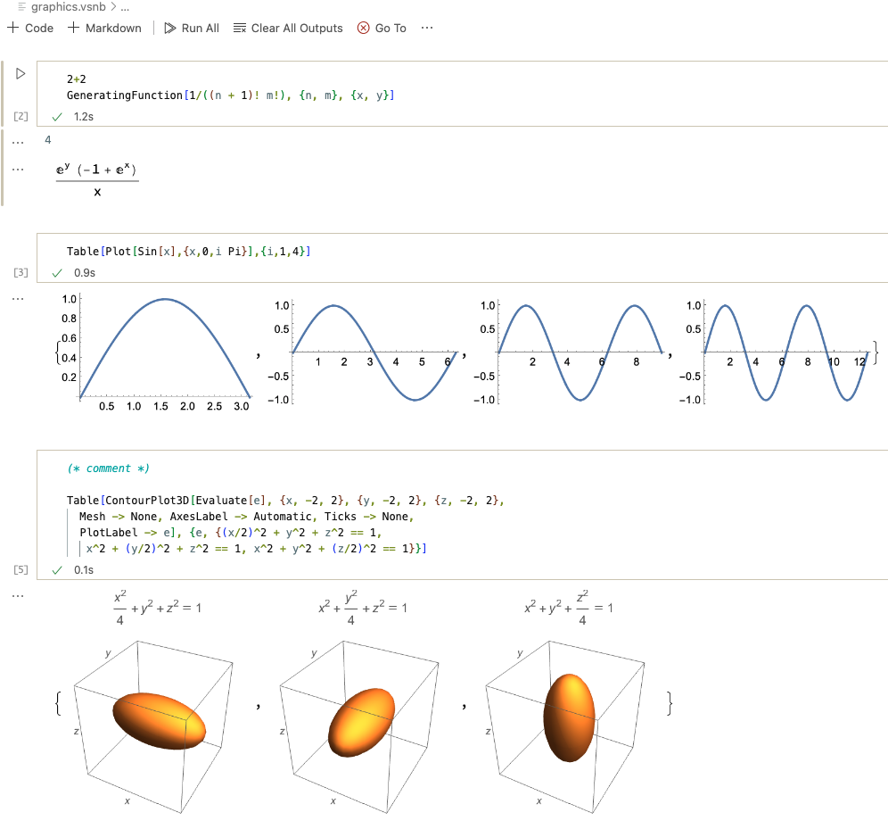
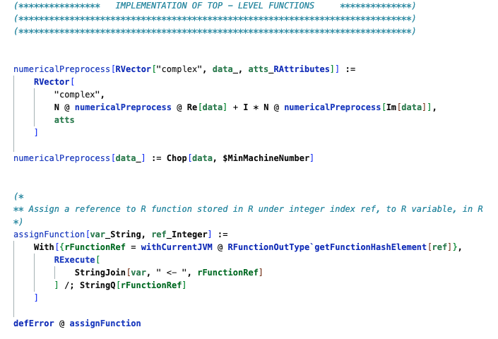
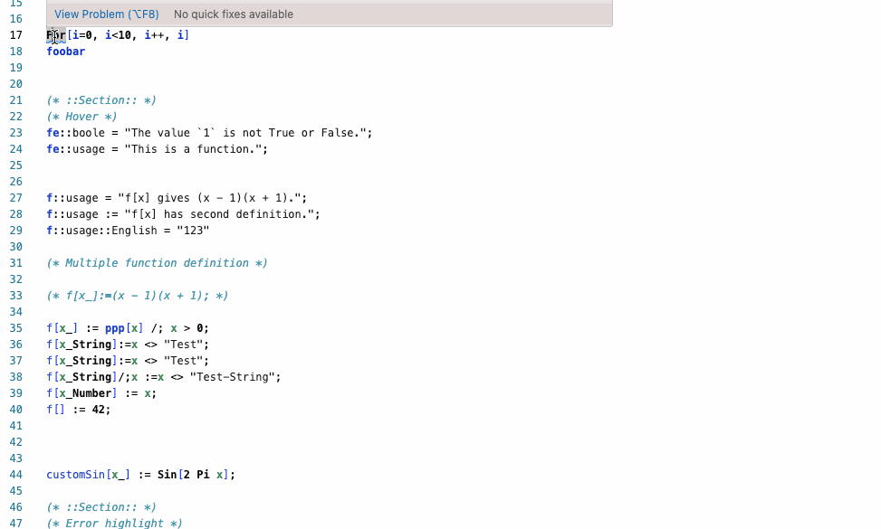
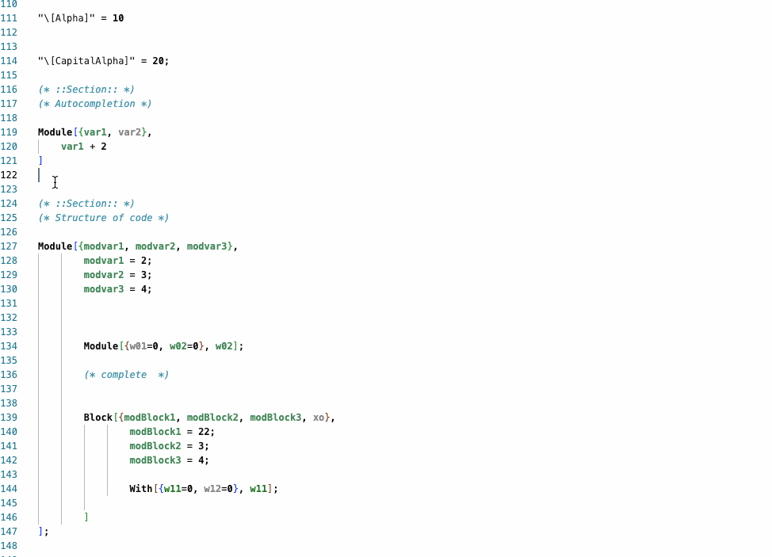

# Wolfram Language extension for Visual Studio Code

This extension provides support for [Wolfram Language](https://www.wolfram.com/language) in Visual Studio Code. 

## Introduction

[Wolfram Language](https://www.wolfram.com/language) is a symbolic language, designed with the breadth and unity needed to develop powerful programs quickly. The philosophy of Wolfram Language is to build as much knowledge—about algorithms and the world—into the language as possible. Wolfram Language represents everything—data, formulas, code, graphics, documents, interfaces, etc.—as symbolic expressions, making possible a new level of programming flexibility and power. 

The primary way to work in Wolfram Language is through [Wolfram Notebooks](https://www.wolfram.com/notebooks/), which provide a rich environment for creating and sharing documents that combine code, text, graphics and interactive interfaces. These notebooks can be created and edited in [Wolfram Desktop](https://www.wolfram.com/wolfram-one/) and the [Wolfram Cloud](https://www.wolfram.com/cloud/).

For developers who prefer to work in a text editor, this extension provides support for Wolfram Language in Visual Studio Code. 

The extension currently provides:

- Syntax highlighting for Wolfram Language source files
- Hover and completion support for Wolfram system functions
- Basic VS Code-style notebook support for `.vsnb` files
- Terminal and kernel integration for running Wolfram Language code
- MCP server integration for VS Code chat

## Installation

Install the extension from the VS Code Extensions view or from the Visual Studio Code Marketplace. After installation, the extension will try to locate a Wolfram installation automatically using standard OS-specific locations. In most cases, the extension will automatically find the Wolfram Language system path if the Wolfram app is installed in the default location. 

## Configuration

If the system path is not found, you can specify the path in the extension settings. You can open the extension settings by clicking the gear icon at the top of this page and selecting `Extension Settings` from the dropdown menu. In the Settings window that opens, search for `Wolfram: System Path` and enter the path to the Wolfram Language kernel executable.

### Main settings

- `wolfram.systemPath`: Path to the Wolfram installation. You can set this to `Automatic` to find the system path automatically from the default paths, or specify the system path directly.
- `wolfram.lsp.serverEnabled`: Enables or disables the Wolfram LSP server.
- `wolfram.notebook.kernelEnabled`: Enables or disables notebook evaluation.
- `wolfram.mcp.serverEnabled`: Enables or disables the Wolfram MCP server integration.

### Recommended setup flow

1. Install the extension.
2. Open VS Code Settings.
3. Search for `wolfram`.
4. If needed, set `wolfram.systemPath`.
5. Confirm that notebook or MCP features are enabled if you plan to use them.

For more information on configuring the extension, see the [Configuration Details](Docs/configuration-details.md) page.

## Extension features overview

### AI features

This extension includes a built-in Wolfram AI MCP server that integrates with VS Code's chat.

**Setup:**

1. In the Chat panel, click the **Configure tools** button on the right:  
   

2. You will see the **WolframAI** MCP server listed. Click **Update Tools** to install the latest tools:  
   

3. Once updated, all Wolfram AI tools will be available:  
   

**Usage: Evaluation**

> use #wolframai to integrate sin(x)^4 from 0 to 2

Ask a question in the chat session:  

And get the answer:  

**Usage: Generate TestReport**

> Get a report of the results of the tests from a file.

Ask for a TestReport in the chat session:  

And get the answer:  

### Notebook features

This extension provides support for creating the more basic VS Code&ndash;style notebooks that can run Wolfram Language inputs. These notebooks are created with the `.vsnb` extension. These notebooks support basic output like text, static graphics, warnings and messages.

For full [Wolfram Notebook](https://www.wolfram.com/notebooks) support, use [Wolfram Desktop](https://www.wolfram.com/one) or [Wolfram Cloud](https://www.wolfram.com/cloud).

### Syntax Highlighting

Syntax highlighting makes your Wolfram Language code easier to read and understand:

### Themes

This extension provides several themes, including syntax highlighting for Wolfram Language. The themes provided are:

* Wolfram (Default)&mdash;Provides a light theme with default Wolfram notebook syntax colors. 
* Wolfram (Light)&mdash;Provides a light theme with muted colors.
* Wolfram (Dark)&mdash;Provides a dark theme.
* Wolfram (Dark Rainbow)&mdash;Provdes a more colorful dark theme.

### Hover support

When you hover over a Wolfram System function, you can see a brief description of the function:

### Completion support

When you start typing a Wolfram System function, you can see a list of possible completions:

